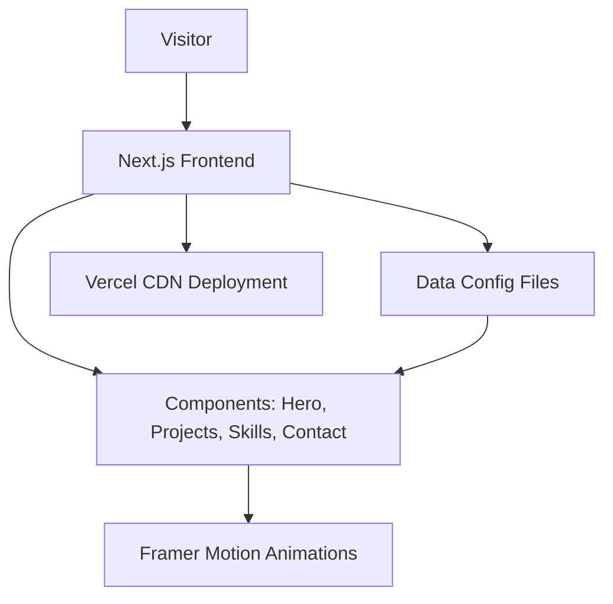

# 🧠 Vipul Parmar — AI & Deep Learning Portfolio

> *"Building trustworthy, explainable AI — one model at a time."*

A personal developer portfolio built with **Next.js**, **TypeScript**, and **Tailwind CSS** — designed to present my work in computer vision, medical AI, and deep learning to recruiters, researchers, and technical reviewers.

---

## 🔗 Live Demo

**Website:** [portfolio-main-tan-three.vercel.app](https://portfolio-main-tan-three.vercel.app/)

---

## 👤 About Me

I am a final-year B.Tech student in **Artificial Intelligence and Data Science** at Shah And Anchor Kutchi Engineering College, Mumbai (CGPA: 8.0), graduating in 2026.

My work sits at the intersection of **explainable AI**, **medical imaging**, and **deep learning research**. I build systems that don't just perform well — they can be understood, trusted, and deployed responsibly.

I have a published peer-reviewed paper on CycleGAN-based image style transfer (IRJMETS, May 2025) and am currently developing an explainable chest X-ray anomaly detection pipeline using Swin Transformers on the PadChest dataset.

---

## 🛠️ Tech Stack

| Category | Tools |
|----------|-------|
| **Languages** | Python, Java, C, R |
| **Deep Learning** | PyTorch, TensorFlow, Keras |
| **Computer Vision** | OpenCV, InsightFace, Grad-CAM |
| **ML** | Scikit-learn |
| **Frontend** | Next.js, React, TypeScript, Tailwind CSS |
| **Tools** | Git, GitHub, MySQL |

---

## 🚀 Featured Projects

### 1. Chest X-ray Anomaly Detection & Summary Generation *(Sep 2025 – Present)*
An explainable AI pipeline for chest X-ray understanding using the **PadChest** dataset.

- Unsupervised **Swin Transformer**-based anomaly detection — no labeled data required
- Reconstruction-based and feature-distance anomaly scoring
- Lung segmentation and bone suppression preprocessing
- Working towards radiology-style summary generation aligned with detected abnormalities
- **Tools:** PyTorch, TensorFlow

---

### 2. Image Style Transfer Using CycleGAN *(Jan 2025 – Jul 2025)*
Deep learning-based artistic style transfer via unpaired image-to-image translation.

- Trained CycleGAN models without paired datasets
- Emphasis on style consistency and content preservation
- **Published:** *"Image Style Transfer Using CycleGAN"* — IRJMETS, Vol. 07, Issue 05, May 2025
- **Tools:** TensorFlow, PyTorch, NumPy, Matplotlib

---

### 3. Pneumonia Detection — CNN & ResNet-18 *(May 2024 – Dec 2024)*
Deep learning diagnostic tool for pneumonia detection from chest X-rays.

- Custom CNN and ResNet-18 architectures
- Class imbalance handling and early stopping
- **Grad-CAM** for visual explainability of predictions
- **Tools:** PyTorch, TensorFlow, OpenCV

---

### 4. Deepfake Face Swap Using InsightFace *(Feb 2024 – Mar 2024)*
A face detection and swapping application using deep learning and facial recognition.

- Robust face alignment and detection via **InsightFace**
- Pre/post-processing and blending accuracy via OpenCV
- Focused on performance optimization and realism
- **Tools:** InsightFace, OpenCV, PyTorch

---

## 📂 Folder Structure

```
portfolio/
│
├── src/
│   ├── components/       # UI components (Cards, NavBar, Footer)
│   ├── data/             # Projects, skills, experience config
│   ├── pages/            # Landing, Projects, Contact, About
│   ├── assets/           # Images, icons
│   ├── styles/           # Tailwind global styles
│   ├── App.tsx
│   └── main.tsx
│
├── public/
├── package.json
├── tailwind.config.js
├── tsconfig.json
└── README.md
```

---

## ⚙️ How to Run Locally

### 1. Clone the Repository
```bash
git clone https://github.com/weepull/portfolio.git
cd portfolio
```

### 2. Install Dependencies
```bash
npm install
```

### 3. Start the Dev Server
```bash
npm run dev
```

Open your browser at:
```
http://localhost:3000
```

### 4. Build for Production
```bash
npm run build
```

### 5. Preview Production Build
```bash
npm run preview
```

---

## 🏗️ Architecture



---

## 📜 Certifications & Publications

- 📄 **Published Paper:** *"Image Style Transfer Using CycleGAN"* — IRJMETS, Vol. 07, Issue 05, May 2025
- 🎓 **Advanced Learning Algorithms** — DeepLearning.AI & Stanford University (Coursera)
- 🔐 **Virtual Internship in Cybersecurity**

---

## 📬 Contact

| Platform | Link |
|----------|------|
| **Email** | vipulparmar3018@gmail.com |
| **GitHub** | [github.com/weepull](https://github.com/weepull) |
| **LinkedIn** | [linkedin.com/in/vipul-parmar](https://linkedin.com/in/vipul-parmar) |

---

*Built with focus, curiosity, and a deep interest in making AI systems that humans can actually trust.*
